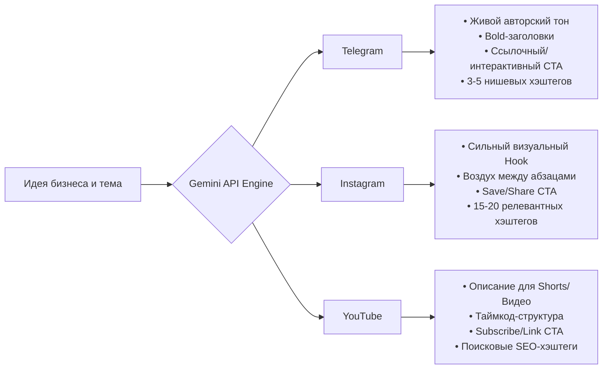
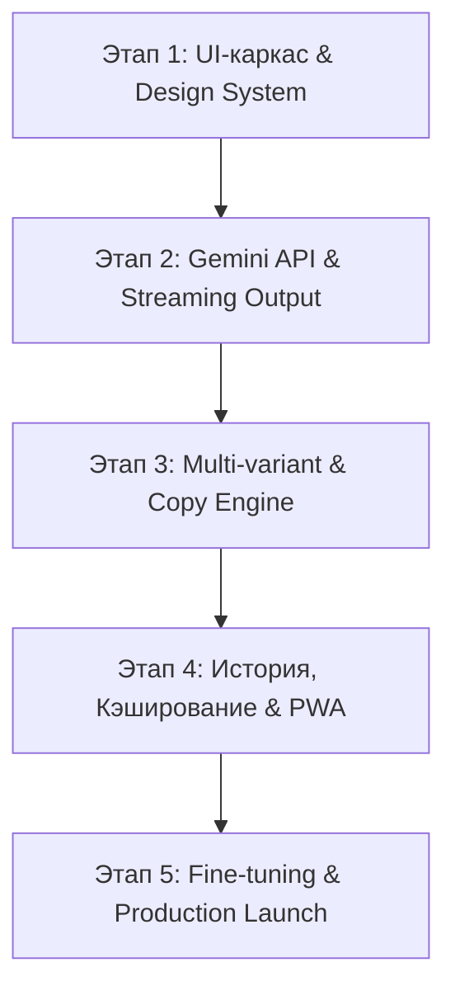

# Product Requirements Document (PRD)
## AI Social Content Studio (Mobile-First Web App)

> **Версия:** 1.0.0  
> **Статус:** Ready for Review & Implementation  
> **Целевая платформа:** Mobile-First Web App (PWA Responsive, 375px–430px base viewport)  
> **LLM Engine:** Google Gemini API (`gemini-3.8-flash` / `gemini-3.5-flash-lite` / `gemini-3.8-pro`)  

---

## 1. Обзор продукта и цели

### 1.1. Концепция
**AI Social Content Studio** — это премиальное, мобильно-ориентированное веб-приложение, предназначенное для предпринимателей, маркетологов, экспертов и контент-мейкеров. Сервис трансформирует краткую идею и контекст бизнеса в профессиональные, готовые к публикации посты для ключевых платформ: **Telegram, Instagram и YouTube**.

Генерация происходит в режиме реального времени («живой» streaming/typewriter вывод), предлагает **3 разноплановых варианта**, позволяет быстро перегенерировать как весь пост, так и отдельные блоки, а также сохраняет историю с возможностью **копирования в 1 клик**.

### 1.2. Ключевые цели продукта (KPIs)
- **Time to Content:** сокращение времени создания готового поста с 20-30 минут до **10-15 секунд**.
- **Effortless UX:** генерация качественного поста в **3 тапа** (выбор соцсети → короткая идея → кнопка «Создать»).
- **Conversion to Copy:** более 85% сессий завершаются копированием сгенерированного поста.
- **Thumb-Friendly Ergonomics:** 100% ключевых интерактивных зон расположены в нижней части экрана под большой палец.

---

## 2. Анализ и деконструкция визуального стиля (Design Reference)

На основе предоставленного референса мобильного интерфейса сформирована дизайн-система: **Warm Editorial / Modern Quiet Luxury**. Она сочетает теплую песочную палитру, глубокий кофейно-черный контраст, утонченную типографику и скругленные тактильные карточки.

### 2.1. Цветовая палитра (Color Palette)

| Роль тона | HEX | Описание и применение |
| :--- | :--- | :--- |
| **Canvas Background** | `#F8F5F0` | Теплый льняной/фарфоровый фон страниц, снижающий нагрузку на глаза |
| **Surface Light (Cards)** | `#FFFFFF` | Чисто-белые карточки с мягкой тенью и тонким бордером для разделения |
| **Surface Muted** | `#F1EBE1` | Вторичные карточки, подложки инпутов и неактивные теги |
| **Dark Contrast Canvas** | `#181615` | Глубокий теплый эспрессо/графит для акцентных экранов, шапок и темных карточек |
| **Text Primary (Dark)** | `#191715` | Основной текст на светлом фоне, максимальная читаемость |
| **Text Secondary** | `#7D756C` | Второстепенные подписи, плейсхолдеры, таймстампы |
| **Text Inverted** | `#FBF9F5` | Текст на темных карточках и контрастных кнопках |
| **Accent Gold / Bronze**| `#C5A880` | Благородное шампанское/бронза для активных иконок, бейджей и ключевых акцентов |
| **Subtle Border** | `rgba(25, 23, 21, 0.08)` | Едва заметные теплые границы карточек (1px solid) |

### 2.2. Типографика (Typography Rules)
- **Шрифт:** `Plus Jakarta Sans` или `Manrope` (геометрический гротеск с превосходной кириллицей).
- **Фирменный прием:** **Двухтоновый акцент в заголовках** (сочетание Regular и Bold начертаний в одном предложении):
  - *Пример:* `Контент` **для результатов**, `Генерация` **в один клик**.
- **Иерархия размеров:**
  - `Hero / Screen Title`: 28px – 32px, tracking -0.02em, line-height 1.15
  - `Section Title`: 20px – 22px, SemiBold
  - `Card Title / Hook`: 16px – 18px, Bold
  - `Body / Generated Post`: 15px, Regular, line-height 1.55
  - `Chips / Micro-copy`: 12px – 13px, Medium / Uppercase tracking 0.05em

### 2.3. Характерные UI-компоненты из референса
1. **Pill Buttons (Кнопки-капсулы):**  
   Полностью скругленные кнопки (`rounded-full` / `border-radius: 9999px`) высотой 52–56px. Слева — текст действия, справа — белый круг с темной стрелкой `→` или иконкой генерации `✦`.
2. **Segmented Filter Chips:**  
   Горизонтальный скролл пилюль-переключателей платформ (`Telegram`, `Instagram`, `YouTube`) с мгновенным переключением состояния (активная — черный фон с белым текстом, неактивная — мягкий песочный фон).
3. **Squircle Cards (Скругление 24px–28px):**  
   Мягкие крупные радиусы скругления создают премиальный тактильный опыт.
4. **Accordion / Expandable Sections:**  
   Минималистичные раскрывающиеся секции с круглыми бейджами `+` и `-` для просмотра параметров генерации и истории.
5. **Thumb-Driven Sticky Bar:**  
   Нижняя плавающая панель с главной кнопкой действия «Сгенерировать посты», доступной всегда под большим пальцем.

---

## 3. Целевые платформы и специфика генерации

AI-движок адаптирует стилистику, форматирование и длину под выбранный канал:



---

## 4. Функциональные требования (Features & Capabilities)

### 4.1. Входные данные (Input Module)
- **Описание бизнеса / Профиль бренда (Business Profile):**
  - Текстовое поле с автосохранением в локальное хранилище (`localStorage`), чтобы не вводить заново при каждом входе.
  - Подсказки-примеры (быстрый выбор: «Косметология / Бьюти», «IT / SaaS», «Онлайн-школа», «Кофейня / HoReCa», «Личный бренд»).
- **Идея или тема поста (Post Idea / Topic):**
  - Главное поле ввода (textarea с авторесайзом и поддержкой микрофона/голосового ввода).
  - Кнопка быстрых идей («Случайная идея для ниши» / «Трендовый инфоповод»).
- **Выбор соцсети (Platform Selector):**
  - Горизонтальный переключатель в виде капсул:
    - ✈️ **Telegram** (фокус на экспертность, аналитику, вовлечение в комьюнити).
    - 📸 **Instagram** (фокус на сторителлинг, эстетику, вовлечение в карусель/Reels).
    - 🔴 **YouTube** (описание к видео/Shorts, цепляющий сценарий, SEO-хэштеги).
- **Дополнительные настройки (раскрывающийся аккордеон):**
  - Тональность (Tone of Voice): *Экспертный, Дружелюбный, Продающий, Провокационный, Лаконичный*.
  - Цель поста: *Продажа, Вовлечение (комментарии), Экспертность / Обучение, Анонс*.

---

### 4.2. Архитектура выдачи: Структура готового поста
Каждый сгенерированный вариант поста строго разделен на 4 независимых блока с отдельными кнопками копирования:

```
┌──────────────────────────────────────────────────────────┐
│ 1. ЗАГОЛОВОК (Hook / Catchy Title)                       │
│    [ Копировать заголовок ]                              │
├──────────────────────────────────────────────────────────┤
│ 2. ОСНОВНОЙ ТЕКСТ (Body Copy)                            │
│    Разбит на короткие абзацы (1-2 предложения),          │
│    смысловые буллеты, расставленные эмодзи в тему       │
│    [ Копировать текст ]                                  │
├──────────────────────────────────────────────────────────┤
│ 3. ПРИЗЫВ К ДЕЙСТВИЮ (Call to Action / CTA)              │
│    Четкое, мотивирующее действие (комментарий, переход,   │
│    сохранение, заявка в директ/бота)                     │
│    [ Копировать CTA ]                                    │
├──────────────────────────────────────────────────────────┤
│ 4. ХЭШТЭГИ (Hashtags)                                    │
│    Оптимальный подбор с учетом платформы                 │
│    [ Копировать хэштеги ]                                │
├──────────────────────────────────────────────────────────┤
│ [ ⚡ КОПИРОВАТЬ ВЕСЬ ПОСТ В 1 КЛИК ]                     │
│ [ 🔄 ПЕРЕГЕНЕРИРОВАТЬ ЭТОТ ВАРИАНТ ]                     │
└──────────────────────────────────────────────────────────┘
```

---

### 4.3. Несколько вариантов постов (Multi-Variant Carousel)
При одном запросе система параллельно или последовательно генерирует **3 альтернативных варианта**:
1. **Вариант 1: «Прямой & Продающий» (Direct & Action-Oriented)** — фокус на оффер, выгоду и конверсию.
2. **Вариант 2: «Сторителлинг & Вовлечение» (Storytelling & Empathy)** — через проблему клиента, личный опыт или кейс.
3. **Вариант 3: «Экспертный & Трендовый» (Authority & Insights)** — полезные советы, факты, цифры и глубина.

**UX переключения:**
- В верхней части карточки результата — компактный переключатель: `[ Вариант 1 ]` `[ Вариант 2 ]` `[ Вариант 3 ]` либо горизонтальный свайп-слайдер с точками пагинации (Dots indicator, как на мобильном референсе).

---

### 4.4. Постепенный ввод / Streaming Output
- Генерация не блокирует экран «лоадером»: текст появляется плавно потоком (Server-Sent Events / Gemini Streaming API) в реальном времени.
- При стриминге пользователь видит мягкую анимацию курсора печати и мгновенно может начать читать хук и заголовок, пока генерируются хэштеги.
- Кнопка «Остановить генерацию», если результат уже удовлетворяет или нужно прервать процесс.

---

### 4.5. Перегенерация (Regeneration & Refinement)
1. **Полная перегенерация:**
   - Кнопка `«Сгенерировать другие варианты»` с возможностью изменить вводные параметры в один тап.
2. **Умная точечная перегенерация (Modular Re-roll):**
   - Возможность перегенерировать только Заголовок (`«Сделай хук более дерзким»`).
   - Перегенерировать только CTA (`«Смени цель на комментарии в чате»`).
   - Перегенерировать только Хэштеги (`«Добавь гео-хэштеги»`).

---

### 4.6. История постов и копирование в один клик
- **1-Click Copy Engine:**
  - При нажатии на кнопку `«Копировать пост»` — полный готовый текст форматируется (заголовок + отступы + тело + CTA + хэштеги) и копируется в буфер обмена (`navigator.clipboard`).
  - Тактильный отклик (Haptic Feedback на смартфонах) + элегантный всплывающий тост `«Скопировано в буфер обмена! ✓»`.
- **Вкладка «История» (Post History):**
  - Локальное хранение до 200 последних генераций (`IndexedDB` / `localStorage`).
  - Фильтрация по иконкам соцсетей: `Все`, `Telegram`, `Instagram`, `YouTube`.
  - Поиск по ключевым словам.
  - Кнопка быстрого добавления в `Избранное (★)`.
  - Кнопка быстрого повторного копирования прямо из карточки истории без открытия детального вида.

---

## 5. Техническая архитектура и интеграция с Gemini API

### 5.1. Утвержденный технологический стек
- **Framework:** **Next.js 15 (App Router)** с TypeScript и React 19.
- **Стилизация & UI:** Tailwind CSS 4.0, кастомные токены дизайн-системы (Warm Minimalist / Luxury Aesthetic).
- **Иконки & Анимации:** `lucide-react`, `framer-motion` (свайпы карточек вариантов, микроанимации копирования).
- **Архитектура безопасности & API-ключей (BYOK - Bring Your Own Key):**
  - Пользователь указывает свой Gemini API ключ в элегантной модалке/шторке настроек.
  - Ключ сохраняется локально в защищенном хранилище браузера (`localStorage`), никогда не логируется и не хранится на сторонних серверах.
  - Запросы к Gemini API отправляются либо напрямую с клиента через `@google/genai` (поддерживая прямой стриминг), либо через локальный Next.js Route Handler (`/api/generate`) с передачей ключа в заголовке `x-gemini-api-key`.
- **Клиентское хранилище:** `IndexedDB` (библиотека `dexie` / `idb`) для неограниченной истории постов и сохраненных профилей бизнеса.
- **PWA & Mobile-First:** `next-pwa` / Web App Manifest, метатеги для мобильных браузеров (iOS notch, safe-areas, prevent pinch-to-zoom).

### 5.2. Спецификация системного промпта и Structured JSON

Для обеспечения стабильного разделения полей (Заголовок, Текст, CTA, Хэштеги) используется режим структурированного ответа (JSON Schema / Controlled Generation):

```json
{
  "type": "object",
  "properties": {
    "variants": {
      "type": "array",
      "items": {
        "type": "object",
        "properties": {
          "style_name": { "type": "string", "description": "Например: Продающий, Сторителлинг, Экспертный" },
          "headline": { "type": "string", "description": "Цепляющий заголовок/крючок внимания" },
          "body": { "type": "string", "description": "Основной текст поста с абзацами и эмодзи" },
          "cta": { "type": "string", "description": "Призыв к конкретному действию" },
          "hashtags": { 
            "type": "array", 
            "items": { "type": "string" },
            "description": "Массив хэштегов с решеткой #"
          }
        },
        "required": ["style_name", "headline", "body", "cta", "hashtags"]
      }
    }
  },
  "required": ["variants"]
}
```

### 5.3. Системный промпт (Prompt Architecture)
```text
Ты — первоклассный AI-копирайтер и контент-стратег с 10-летним опытом вирального маркетинга.
Твоя задача — превратить описание бизнеса и базовую идею в 3 конверсионных, идеально отформатированных поста для указанной соцсети:
- Если Telegram: упор на доверительный авторский диалог, структурированные списки, минималистичные эмодзи, нативный CTA в комментарии/бота.
- Если Instagram: первые 3 секунды хука до ката «еще», ритмичный текст с воздушными отступами, эмоциональный CTA сохранить/переслать, блок из 10-15 целевых тегов.
- Если YouTube: хук для первых кадров видео/Shorts, информативное описание с ключевыми фразами для алгоритма рекомендаций, таймкод-разметка (если применимо), хэштеги внизу.

Выдавай ответ строго в соответствии с JSON схемой на русском языке.
```

---

## 6. Детализация экранов и мобильных пользовательских сценариев (User Journey)

### 6.1. Экран 1: Конструктор (Studio Home)
- **Top Bar:** Минималистичный логотип `AesthSocial` или `Studio✦`, справа — кнопка перехода в «Историю» со счетчиком сохраненных постов.
- **Hero Title:** Двухтоновый заголовок в референс-стиле:
  > `Создавайте` **виральный контент**
- **Brand Context (Карточка-аккордеон):**
  - Поле ввода «О вашем бизнесе/проекте».
  - Пометка: *«Сохраняется автоматически»*.
- **Platform Selector:**
  - Горизонтальные пилюли с иконками: `Telegram`, `Instagram`, `YouTube`.
- **Idea Input (Главная карточка):**
  - Большое текстовое поле ввода: *«О чем хотите рассказать? (например: новая услуга, личный инсайт, кейс клиента...)»*.
  - Микро-чипы быстрых идей: `[ Акция ]` `[ Ошибка новичка ]` `[ Кейс недели ]`.
- **Bottom Action Dock (Зафиксирован снизу):**
  - Кнопка-капсула черного цвета:  
    `[ ✦ Сгенерировать 3 варианта  → ]`

---

### 6.2. Экран 2: Результаты генерации (Variants Viewer)
- **Status Indicator:** При стриминге отображается мягкий прогресс-бар и пульсирующий бейдж `Генерируем варианты...`.
- **Tabs / Pagination:** 
  - `[ Вариант 1: Продающий ]` `[ Вариант 2: История ]` `[ Вариант 3: Экспертный ]`.
- **Active Post Card (Белая карточка с радиусом 24px):**
  - **Блок Заголовка:** Жирный контрастный текст + иконка быстрого копирования справа.
  - **Блок Тела:** Форматированный текст с аккуратным межстрочным интервалом.
  - **Блок CTA:** Выделен мягким песочным бейджем.
  - **Блок Хэштегов:** Теги в виде кликабельных капсул.
- **Нижний блок действий:**
  - Главная темная кнопка: `[ Скопировать весь пост (1 клик) 📋 ]`.
  - Вторичные кнопки: `[ 🔄 Другие варианты ]` и `[ ✏️ Доработать с ИИ ]`.

---

### 6.3. Экран 3: История и Избранное (Archive & History)
- Верхний фильтр: `Все` `Telegram` `Instagram` `YouTube` `★ Избранное`.
- Поиск по тексту постов.
- Список карточек в стиле FAQ-аккордеона из референса:
  - Дата и бейдж соцсети.
  - Заголовок поста (Bold).
  - Превью первых 2 строк.
  - Кнопка мгновенного копирования `[ 📋 ]` без необходимости разворачивать весь пост.

---

## 7. Нефункциональные требования (NFR)

1. **Производительность и задержка:**
   - Первые токены стриминга (Time to First Token, TTFT) должны появляться менее чем за **1.2 секунды** при вызове Gemini Flash.
2. **Оффлайн и отказоустойчивость:**
   - Если соединение прервалось во время генерации, пользователю предлагается повторить запрос с сохранением введенных идей.
   - История и профиль бизнеса полностью доступны даже в режиме офлайн благодаря `IndexedDB`.
3. **Безопасность и хранение ключей:**
   - Предусмотреть режим работы как с собственным API-ключом пользователя (BYOK - Bring Your Own Key, сохраняется в зашифрованном виде в локальном хранилище браузера), так и через защищенный бэкенд-прокси (Next.js API route) с ограничением частоты запросов (Rate Limiting).
4. **Адаптивность и PWA:**
   - Приложение идеально отображается на экранах от 360px до 430px (iPhone SE, iPhone 14/15/16 Pro, Samsung Galaxy S23/S24).
   - Поддержка `manifest.json` и Service Worker для установки как нативное веб-приложение на главный экран смартфона (Add to Home Screen).

---

## 8. Дорожная карта реализации (Roadmap)



- **Этап 1 (UI & Design Kit):** Верстка базовых компонентов в стилистике референса (песочный фон, шрифты, капсульные кнопки, фильтр-чипы, аккордеоны).
- **Этап 2 (AI Integration & Streaming):** Подключение SDK Gemini, настройка системного промпта, реализация потокового вывода (typewriter effect).
- **Этап 3 (Мульти-варианты и Копирование):** Свайп-карусель 3 вариантов постов, разбиение на Заголовок / Текст / CTA / Хэштеги, реализация 1-click копирования с тактильным откликом.
- **Этап 4 (История & Оффлайн):** Интеграция IndexedDB, сохранение контекста бизнеса, фильтрация истории по платформам.
- **Этап 5 (Полировка & PWA):** Добавление иконок PWA, сплеш-скрина, тестирование на реальных мобильных устройствах iOS и Android.
