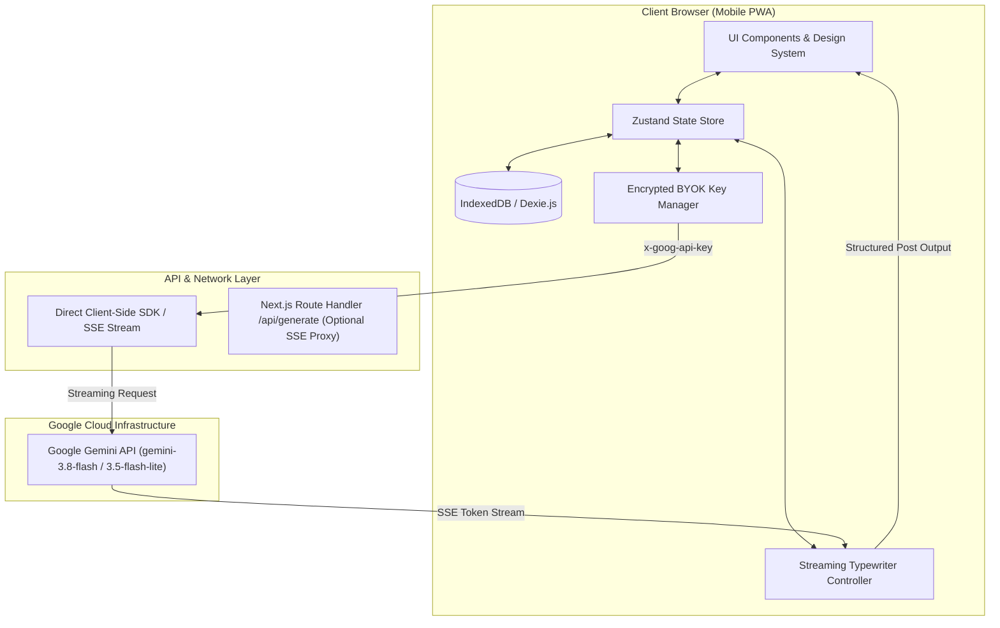
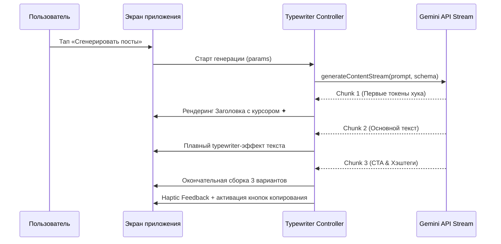

# Technical Specification (SPEC)
## AI Social Content Studio (Mobile-First Web App)

> **Версия спецификации:** 1.0.0  
> **Связанный PRD:** [PRD.md](file:///d:/Yaraticilik/SMM%20generator/PRD.md)  
> **Стек:** Next.js 15 (App Router), React 19, TypeScript, Tailwind CSS 4.0, Framer Motion, Lucide React, IndexedDB (Dexie.js), `@google/genai` (BYOK).  
> **Целевой дизайн:** Warm Editorial / Quiet Luxury (на основе утвержденного мобильного референса).  

---

## 1. Архитектура системы (System Architecture)

Система строится по принципу **Mobile-First Client-Centric Architecture** с архитектурой **BYOK (Bring Your Own Key)**. Вся обработка состояния, кэширование и вызовы ИИ происходят в браузере пользователя, что обеспечивает мгновенный отклик, нулевую стоимость серверной инфраструктуры и полную конфиденциальность бизнес-данных.



---

## 2. Структура проекта (Directory & File Tree)

Проект разворачивается по стандартам Next.js 15 App Router:

```text
d:/Yaraticilik/SMM generator/
├── public/
│   ├── icons/               # PWA иконки (192x192, 512x512, apple-touch-icon)
│   ├── manifest.json        # Web App Manifest для установки на экран смартфона
│   └── favicon.ico
├── src/
│   ├── app/
│   │   ├── layout.tsx       # Root layout, подключение шрифтов, метатеги viewport
│   │   ├── page.tsx         # Главная страница (Studio Dashboard)
│   │   ├── history/
│   │   │   └── page.tsx     # Страница истории генераций и избранного
│   │   ├── settings/
│   │   │   └── page.tsx     # Настройки BYOK API ключа и пресетов брендов
│   │   ├── globals.css      # Tailwind директивы, кастомные анимации и скроллбары
│   │   └── api/
│   │       └── generate/
│   │           └── route.ts # Опциональный Next.js SSE streaming proxy
│   ├── components/
│   │   ├── layout/
│   │   │   ├── Header.tsx           # Минималистичная мобильная шапка
│   │   │   ├── BottomNav.tsx        # Тактильный нижний док навигации
│   │   │   └── Container.tsx        # Ограничитель ширины (max-w-md mx-auto)
│   │   ├── studio/
│   │   │   ├── PlatformSelector.tsx # Пилюли выбора платформы (TG, IG, YT)
│   │   │   ├── BusinessProfileCard.tsx # Аккордеон с контекстом бренда
│   │   │   ├── IdeaInputCard.tsx    # Поле ввода идеи + быстрые теги
│   │   │   ├── GenerateButton.tsx   # Главная кнопка-капсула со стрелкой
│   │   │   └── ToneModal.tsx        # Выбор тональности и целей
│   │   ├── output/
│   │   │   ├── VariantCarousel.tsx  # Переключатель 3 вариантов (Tabs + Dots)
│   │   │   ├── PostPreviewCard.tsx  # Карточка поста (Hook, Body, CTA, Tags)
│   │   │   ├── StreamingCursor.tsx  # Анимированный курсор печати текста
│   │   │   ├── OneClickCopyBar.tsx  # Кнопка копирования всего поста + Haptic
│   │   │   └── ReGenerateMenu.tsx   # Модалка/меню точечной перегенерации
│   │   ├── history/
│   │   │   ├── HistoryItemCard.tsx  # Карточка поста в стиле аккордеона FAQ
│   │   │   └── HistoryFilterChips.tsx # Фильтр истории (Все, TG, IG, YT, ★)
│   │   └── ui/
│   │       ├── PillButton.tsx       # Капсульная кнопка в стиле референса
│   │       ├── Accordion.tsx        # Секция с круглыми иконками +/-
│   │       ├── Toast.tsx            # Элегантное всплывающее уведомление
│   │       └── KeySetupDrawer.tsx   # Шторка первичного ввода Gemini API Key
│   ├── lib/
│   │   ├── gemini/
│   │   │   ├── client.ts            # Инициализация @google/genai с BYOK ключом
│   │   │   ├── prompts.ts           # Системные промпты под TG, IG, YouTube
│   │   │   └── schema.ts            # JSON-схема структурированной генерации
│   │   ├── db/
│   │   │   └── index.ts             # Dexie.js база данных (IndexedDB)
│   │   ├── hooks/
│   │   │   ├── useGeminiStream.ts   # Хук управления потоковой генерацией
│   │   │   ├── useClipboard.ts      # Хук копирования с Haptic Feedback
│   │   │   └── useHistory.ts        # Хук запросов к IndexedDB
│   │   ├── store/
│   │   │   └── useAppStore.ts       # Zustand стор глобального состояния
│   │   └── utils/
│   │       ├── haptics.ts           # Вибрация для мобильных устройств
│   │       └── formatters.ts        # Сборка финального текста поста для копирования
│   └── types/
│       ├── post.ts                  # Интерфейсы постов, вариантов и истории
│       └── config.ts                # Конфигурация платформы и настроек
├── package.json
├── tsconfig.json
├── tailwind.config.ts
└── next.config.ts
```

---

## 3. Модели данных и TypeScript спецификации (`src/types/post.ts`)

```typescript
export type SocialPlatform = 'telegram' | 'instagram' | 'youtube';

export type ToneOfVoice = 
  | 'expert'         // Экспертный, авторитетный
  | 'friendly'       // Дружелюбный, теплый
  | 'selling'        // Прямой продающий, оффер
  | 'provocative'    // Провокационный, привлекающий внимание
  | 'concise';       // Лаконичный, минимум воды

export type PostGoal = 
  | 'sales'          // Продажа / Лидогенерация
  | 'engagement'     // Вовлечение в комментарии
  | 'authority'      // Демонстрация экспертности
  | 'announcement';  // Анонс события / новости

export interface PostVariant {
  id: string;
  styleName: string;         // Например: "Продающий оффер", "Сторителлинг", "Экспертный разбор"
  headline: string;          // Цепляющий хук / заголовок
  body: string;              // Основной текст поста с переносами и эмодзи
  cta: string;               // Призыв к действию
  hashtags: string[];        // Массив хэштегов (#бизнес #smm)
}

export interface GenerationParams {
  businessDescription: string;
  postIdea: string;
  platform: SocialPlatform;
  tone: ToneOfVoice;
  goal: PostGoal;
  customInstructions?: string;
}

export interface HistoryItem {
  id: string;
  createdAt: number;         // Timestamp (ms)
  platform: SocialPlatform;
  topic: string;             // Идея/тема, введенная пользователем
  variants: PostVariant[];   // Все 3 сгенерированных варианта
  selectedVariantIndex: number;
  isFavorite: boolean;
}

export interface UserSettings {
  geminiApiKey: string;
  preferredModel: 'gemini-2.5-flash' | 'gemini-2.0-flash' | 'gemini-1.5-flash-lite';
  savedBusinessProfile: string;
  defaultTone: ToneOfVoice;
  autoSaveHistory: boolean;
}
```

---

## 4. Спецификация дизайн-токенов Tailwind (согласно референсу)

В соответствии с прикрепленным референсом интерфейса конфигурируются следующие токены:

```typescript
// tailwind.config.ts
export default {
  theme: {
    extend: {
      colors: {
        canvas: {
          light: '#F8F5F0',       // Теплый льняной фон экрана
          dark: '#181615',        // Глубокий кофейно-графитовый фон
          muted: '#F1EBE1',       // Подложки полей ввода и пассивных чипов
        },
        surface: {
          light: '#FFFFFF',       // Белая карточка поста
          cardDark: '#23201D',    // Темная карточка
          border: 'rgba(25, 23, 21, 0.08)',
          borderDark: 'rgba(255, 255, 255, 0.1)',
        },
        text: {
          primary: '#191715',     // Темный контрастный текст
          secondary: '#7D756C',   // Приглушенный теплый серый
          inverted: '#FBF9F5',    // Белый текст на темном фоне
        },
        brand: {
          bronze: '#C5A880',      // Благородный золотисто-бронзовый акцент
          bronzeLight: '#E6D7C3',
          darkButton: '#181615',  // Черная капсульная кнопка
        }
      },
      borderRadius: {
        'squircle': '26px',       // Радиус основных карточек из референса
        'pill': '9999px',         // Радиус кнопок-капсул и фильтров
      },
      boxShadow: {
        'soft-card': '0 8px 30px rgba(0, 0, 0, 0.04)',
        'dock': '0 -8px 25px rgba(24, 22, 21, 0.05)',
      }
    }
  }
};
```

---

## 5. Интеграция с Gemini API и BYOK Engine

### 5.1. Управление ключом (Security & Storage)
- Ключ вводится через `KeySetupDrawer` с маскированием ввода (`••••••••••••••`).
- Хранение в `localStorage.getItem('smm_gemini_api_key')`.
- Перед сохранением выполняется проверочный запрос `gemini.models.list()` или микро-запрос `"Ping"` для валидации ключа.
- При ошибке `401 / 403` интерфейс автоматически открывает шторку с предупреждением: *«Неверный API ключ Gemini. Пожалуйста, проверьте его в настройках»*.

### 5.2. Спецификация промпта и Structured JSON Schema

Для получения 3 вариантов с разделением на Заголовок, Тело, CTA и Хэштеги используется Structured Outputs API:

```typescript
// src/lib/gemini/schema.ts
export const contentGenerationSchema = {
  type: "OBJECT",
  properties: {
    variants: {
      type: "ARRAY",
      description: "Ровно 3 стилистических варианта поста",
      items: {
        type: "OBJECT",
        properties: {
          styleName: { 
            type: "STRING", 
            description: "Краткое название стиля (напр. 'Продающий оффер', 'Сторителлинг', 'Экспертный совет')" 
          },
          headline: { 
            type: "STRING", 
            description: "Мощный цепляющий хук/заголовок (1-2 строки)" 
          },
          body: { 
            type: "STRING", 
            description: "Основное тело поста, структурированное абзацами и эмодзи" 
          },
          cta: { 
            type: "STRING", 
            description: "Призыв к конкретному действию (CTA)" 
          },
          hashtags: { 
            type: "ARRAY", 
            items: { type: "STRING" },
            description: "Массив релевантных хэштегов с символом #" 
          }
        },
        required: ["styleName", "headline", "body", "cta", "hashtags"]
      }
    }
  },
  required: ["variants"]
};
```

### 5.3. Системные директивы для платформ (`src/lib/gemini/prompts.ts`)

| Платформа | Специфика хука | Форматирование тела | Специфика CTA | Специфика хэштегов |
| :--- | :--- | :--- | :--- | :--- |
| **Telegram** | Интригующий заголовок с эмодзи | Списочная структура, короткие абзацы по 2 предложения, жирный шрифт для акцентов | Призыв написать комментарий, перейти по ссылке в закрепе, написать боту | 3–5 узконишевых тегов в конце |
| **Instagram** | Первые 125 символов — максимальный интерес до кнопки «еще» | Ритмичный сторителлинг с воздухом между абзацами, эмодзи как маркеры списков | «Сохрани в закладки, чтобы не потерять», «Напиши слово 'СТАРТ' в Директ» | 10–18 смешанных тегов (высоко- и среднечастотные) |
| **YouTube** | Кликбейтный хук для Shorts или описания видео | 1-2 вводных абзаца с ключевыми SEO-словами + краткий таймкод-план | «Подпишись на канал», «Ссылка на материалы в описании» | 3–5 основных поисковых SEO-тегов |

---

## 6. Механизм постепенного вывода (Streaming Typewriter Controller)

Для создания эффекта «живого» ввода текста используется контроллер потокового рендеринга:



- **Fallback при парсинге JSON-потока:** Во время стриминга сырой текст промежуточно парсится через regex / partial JSON parser (`dirty-json` / `partial-json`), позволяя отображать текст в карточке еще до того, как закрыты все фигурные скобки JSON.
- **Индикация статуса:** Пользователь видит тонкую анимированную полосу золотистого цвета (`#C5A880`) и индикатор `Создаем вариант 1 из 3...`.

---

## 7. Модуль копирования и тактильного отклика (1-Click Copy Engine)

### 7.1. Форматирование текста при копировании (`src/lib/utils/formatters.ts`)
При нажатии на `«Скопировать весь пост»` генерируется чистый текстовый блок:

```text
{headline}

{body}

👉 {cta}

{hashtags.join(' ')}
```

### 7.2. Тактильный отклик (Haptic Feedback)
Для нативного мобильного ощущения при копировании вызывается Web Vibration API:
```typescript
export const triggerHaptic = (type: 'success' | 'tap' | 'error' = 'success') => {
  if (typeof window !== 'undefined' && 'vibrate' in navigator) {
    if (type === 'success') navigator.vibrate([30, 50, 30]); // Двойной тактильный щелчок
    if (type === 'tap') navigator.vibrate(20);               // Мягкий тап
    if (type === 'error') navigator.vibrate([60, 40, 60]);   // Предупреждающий
  }
};
```

### 7.3. Копирование отдельных блоков
В карточке поста у каждого блока (Заголовок, Тело, CTA, Хэштеги) есть микро-кнопка копирования `[ 📋 ]`. При клике копируется только выбранный фрагмент с мгновенным бейджем `Скопировано!`.

---

## 8. Спецификация локальной базы данных (IndexedDB / Dexie)

Для хранения истории без сервера используется легковесная библиотека Dexie.js:

```typescript
// src/lib/db/index.ts
import Dexie, { Table } from 'dexie';
import { HistoryItem } from '@/types/post';

export class SocialStudioDatabase extends Dexie {
  history!: Table<HistoryItem, string>;

  constructor() {
    super('SocialContentStudioDB');
    this.version(1).stores({
      history: 'id, platform, createdAt, isFavorite, topic'
    });
  }
}

export const db = new SocialStudioDatabase();
```

---

## 9. План интерфейсных экранов (UI Blueprint)

```
┌────────────────────────────────────────────────────────┐
│  STATUS BAR (9:41)                          ● 5G [88%] │
├────────────────────────────────────────────────────────┤
│  Studio✦                             [ ⚙️ ]  [ ⭐️ 12 ] │
│                                                        │
│  Создавайте                                            │
│  ВИРАЛЬНЫЙ КОНТЕНТ                                     │
│  Контент для соцсетей за 10 секунд                     │
│                                                        │
│  [ Telegram ]    [ Instagram ]    [ YouTube ]          │  <-- Segmented Pills
│                                                        │
│  ┌─ О вашем бизнесе ────────────────────────── [ + ] ─┐│  <-- Accordion
│  │ Студия премиальной косметологии и лазера...        ││
│  └────────────────────────────────────────────────────┘│
│                                                        │
│  ┌─ Идея или тема поста ─────────────────────────────┐│
│  │ "5 мифов о лазерной эпиляции, в которые           ││
│  │  до сих пор верят девушки..."                     ││
│  │                                                   ││
│  │  [ + Акция ]  [ + Ошибка ]  [ + Инсайд ]          ││  <-- Quick chips
│  └───────────────────────────────────────────────────┘│
│                                                        │
│  ┌─ РЕЗУЛЬТАТ (Вариант 1 из 3) ──────────────────────┐│
│  │ [ Вариант 1 ]  ( Вариант 2 )  ( Вариант 3 )       ││  <-- Switcher
│  │                                                   ││
│  │  ХУК: 🛑 5 мифов о лазере, которые стоят вам денег││
│  │                                                   ││
│  │  ТЕКСТ: Думаете, что лазер — это больно и навсегда││
│  │  оставляет ожоги? Давайте разберем факты...       ││
│  │                                                   ││
│  │  CTA: 💬 Напишите "МИФ" в комменты, пришлем гайд! ││
│  │                                                   ││
│  │  #косметология #лазер #красота #бьюти             ││
│  └───────────────────────────────────────────────────┘│
│                                                        │
│  ┌───────────────────────────────────────────────────┐│
│  │ [ ⚡ Скопировать весь пост (1 клик)           → ] ││  <-- Sticky Pill Button
│  └───────────────────────────────────────────────────┘│
│  [ Студия ]               [ История ]      [ Настройки ]│  <-- Bottom Dock
└────────────────────────────────────────────────────────┘
```

---

## 10. Критерии приемки и верификации (Acceptance Criteria)

- [ ] **BYOK Management:** При первом входе запрашивается API-ключ Gemini с ссылкой на Google AI Studio. Ключ успешно валидируется и сохраняется в `localStorage`.
- [ ] **Выбор соцсетей:** Переключение между Telegram, Instagram и YouTube динамически меняет промпт, целевую длину и правила разметки.
- [ ] **3 варианта выдачи:** При одном нажатии на кнопку генерируются 3 стилистически разных варианта с переключением через вкладки или свайп.
- [ ] **Постепенный вывод (Streaming):** Генерация отображается в реальном времени, не вешая интерфейс.
- [ ] **Копирование в 1 клик:**
  - Нажатие главной кнопки копирует весь пост со всеми 4 блоками.
  - Нажатие на иконку блока копирует только этот блок.
  - Срабатывает виброотклик (на смартфонах) и тост-уведомление.
- [ ] **История постов:** Все созданные посты сохраняются в IndexedDB, доступны офлайн, фильтруются по соцсетям и содержат быстрый поиск.
- [ ] **Mobile-First верстка:** Приложение протестировано в мобильных разрешениях (375px, 390px, 430px) с учетом нижнего отступа (Safe Area) для iPhone и Android.
